<h3><code> Gustavo Soares Ferreira~ $ whoami</code></h3>

  
  

 

<h3><code>gustavosoaresf-dev@github ~ $ ./contributions.sh</code></h3>

  

<code>gustavosoaresf-dev@github ~ $ cat stack.md</code>

 

| Category | Technologies |
|---|---|
| **Languages** | Java 8+, Python, JavaScript, TypeScript |
| **Backend** | Spring Boot, Spring Security (JWT), Spring Data JPA, Hibernate, RESTful APIs |
| **Architecture** | Object-Oriented Programming, MVC, Modular Monolith, Layered Domains |
| **Databases** | PostgreSQL, MySQL, SQL Server, MongoDB, Flyway |
| **Cloud & Infrastructure** | AWS EC2, Azure App Services, Virtual Machines, Blob Storage, SQL Database, Docker |
| **Frontend** | HTML5/CSS3, React |
| **Testing & Tools** | Automated Tests, JaCoCo, Git, GitHub Actions, Data Structures |

 

  <a href="https://linkedin.com/in/gustavo-soaresf">LinkedIn</a> ·
  Mogi das Cruzes, SP, Brazil

